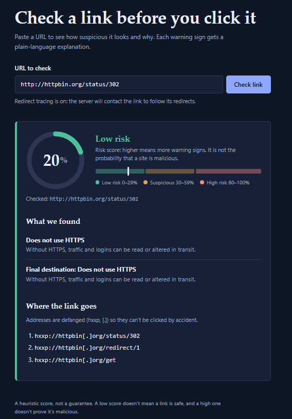
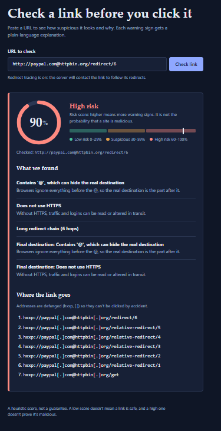

# URL Risk Analyzer

A web tool that rates how suspicious a URL looks and explains why. Paste a link, get a color-coded risk score, the redirect path the link takes, and a plain-language explanation of each warning sign.

| Low risk | High risk |
|---|---|
|  |  |

## Features

- Risk score from 0 to 100%, color-coded: low, suspicious, high
- **URL checks:** IP-address hosts, excessive subdomains, `@` tricks, missing HTTPS, very long URLs
- **Redirect tracing:** follows a link hop by hop and shows the full chain
- **Redirect checks:** long chains, redirect loops, URL shorteners, jumps across many domains, HTTPS-to-HTTP downgrades, and redirects to bare IP addresses
- The final destination is also run through the URL checks
- Blocks requests to private and internal addresses (SSRF protection)

## Run it locally

Requires Python 3.10 or newer.

```
pip install -r requirements.txt
python -m uvicorn app:app --host 127.0.0.1 --port 8000
```

Open http://localhost:8000.

## How it works

- `analyzer.py` contains the scoring and redirect-tracing logic
- `app.py` is a FastAPI server that calls the analyzer
- `static/` contains the web page (HTML, CSS, JavaScript)

## Safety

Redirect tracing is on by default. It makes real requests to the links you enter, following redirects one hop at a time without downloading page content or running any scripts. Requests to private and internal addresses are blocked, and the number of redirects and the request time are capped. Redirect chains are shown defanged so they can't be clicked by accident.

To turn tracing off, set `ENABLE_REDIRECT_TRACE=0`. The site then only analyzes the text of the URL and never contacts it.

Because tracing contacts the link, the link's owner can see your IP address. Use caution when testing real suspicious links.

## Limitations

- The score is a heuristic, not a verdict. A low score does not mean a link is safe.
- It does not run JavaScript, so it can't detect redirects done by a page's scripts.
- It checks the URL and its server redirects only, not the content of the page.
- The internal-address check can be bypassed by a DNS rebinding attack. This is a known gap and a planned fix.

## Author

Michael Anderson